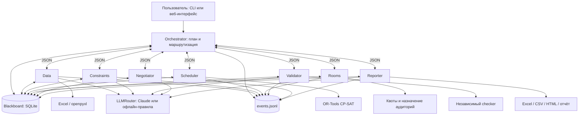

# Многоагентная система составления расписания

Учебный проект AITU по курсу «Artificial intelligence and machine learning». Система строит недельное расписание университета по Excel с учебными планами, группами и аудиториями. Пользователь задаёт дополнительные ограничения на русском или английском языке, а результат получает в Excel, CSV, HTML и локальном веб-интерфейсе.

Расписание ведёт служба 24/7: сотрудники пишут заявки обычными словами («Аудитория C1.3.361 недоступна в среду»), агенты проверяют их, перестраивают расписание от опубликованной версии с минимумом переносов для студентов и публикуют новую версию только без жёстких нарушений. Студенты видят расписание своей группы, что изменилось, и могут добавить его в календарь (`.ics`).

В системе 9 агентов конвейера генерации и 3 агента службы 24/7 (плюс её оркестратор), у каждого отдельная роль. Первое поколение расписания строит генетический алгоритм, время занятий дорабатывает OR-Tools CP-SAT; LLM помогает разбирать требования, выбирать уступки и объяснять результат. Для запуска без API и сети предусмотрены офлайн-правила. В университетском наборе после нормализации: 13 программ, 270 групп и 104 аудитории (по свежему журналу Data). Недельная сетка содержит 72 слота: понедельник–суббота, 08:00–19:50; по умолчанию суббота закрыта.

## Установка и первый запуск

Проверенное окружение — Windows, Python 3.12. Команды выполняются в PowerShell из корня проекта.

```powershell
git clone https://github.com/Almasmm/multi-agent-timetable.git
cd multi-agent-timetable
py -3.12 -m venv .venv
.venv\Scripts\python -m pip install -r requirements.txt

# Программа IT, первый триместр, без внешней LLM.
.venv\Scripts\python -m timetable run --offline --programs IT --seconds 10

# Веб-интерфейс (в том же процессе работает служба 24/7, если её включить).
.venv\Scripts\python -m timetable web --port 8000

# Служба 24/7 без веб-интерфейса (например, задача планировщика Windows или systemd).
.venv\Scripts\python -m timetable autopilot          # работает, пока не остановят (Ctrl+C)
.venv\Scripts\python -m timetable autopilot --once   # довести до спокойного состояния и выйти
```

Откройте <http://127.0.0.1:8000>. Разделы: «Обзор»; «Опубликованное» — сетка группы или аудитории, подсветка изменений, Excel и календарь `.ics`, история версий; «Заявки» — почтовый ящик заявок с вердиктом агента «Приёмная» и решениями диспетчера; «Автопилот» — включение службы, такты, задания, версии, профиль вуза; «Прогоны», «Агенты», «Новый прогон» (в том числе с тёплым стартом от опубликованной версии). Поиск групп, аудиторий и прогонов — клавиша `/`, новая заявка — `N`. Описание API: <http://127.0.0.1:8000/api/docs>. Одновременно выполняется один прогон.

### Служба 24/7

Автопилот включается переключателем в сайдбаре или на странице «Автопилот»; состояние сохраняется в `runs/_service/service.sqlite`, и после перезапуска сервера служба продолжает работу (`TT_AUTOPILOT=auto`; `on` — всегда включать, `off` — никогда). Раз в `TT_AUTOPILOT_TICK` секунд (60) оркестратор службы опрашивает агентов:

1. **Наблюдатель** считает хэш Excel и смотрит входящие заявки.
2. **Приёмная** разбирает новые заявки: принимает правило, отклоняет с причиной (нет такой группы или аудитории) или передаёт диспетчеру.
3. **Наблюдатель** предлагает задание: первая генерация, перегенерация после изменений (с тёплым стартом) или поиск улучшения в простое.
4. Автопилот запускает обычный прогон девяти агентов; **Публикатор** проверяет результат и публикует версию со снимком файлов и объявлением «что изменилось».

Профиль вуза (данные, триместр, программы, постоянные правила, время решателя, частота поиска улучшений, дата начала семестра, допустимая доля переносов) редактируется на странице «Автопилот». Подробнее: [docs/ARCHITECTURE.md](docs/ARCHITECTURE.md#5-служба-247-агенты-ведут-расписание-круглосуточно).

На Linux/macOS создайте окружение командой `python3.12 -m venv .venv` и замените `.venv\Scripts\python` на `.venv/bin/python`. Проверка этого выпуска выполнялась на Windows.

### Входной Excel

По умолчанию загрузчик читает `data/input.xlsx`. Если файл не включён в вашу копию проекта, поместите туда разрешённый к использованию университетский набор. Без него сценарии, зависящие от данных, не воспроизводятся. Другой файл можно передать через `--data "C:\path\input.xlsx"` или загрузить в веб-интерфейсе. Архивные материалы из `dataset-archive/` не нужны для запуска и исключены из Git.

| Листы | Поля |
|---|---|
| Отдельный лист программы, например `IT` | `course_name`, `trimester`, `credits`, `lecture_slots`, `practice_slots`, `lab_slots`, `delivery_mode`, `lecture_precedes_practice` |
| `Groups` | `group_code`, `year`, `headcount`; префикс группы соответствует листу программы |
| `Rooms` | `room_code`, `capacity`, `room_type`, `floor`, `available` |
| `Timeslots` | `slot_index`, `start`, `end`; индекс слота начинается с 1 |

Часы курса делятся на `TT_WEEKS` (по умолчанию 10 недель). Исправления опечаток, округления и пропуски строк фиксируются в отчёте. Формат и нормализация: [loader.py](timetable/domain/loader.py).

## Настройка

Офлайн-режим не требует `.env` и ключа. Для изменения настроек скопируйте шаблон:

```powershell
Copy-Item .env.example .env
```

| Переменная | По умолчанию | Назначение |
|---|---|---|
| `TT_DATA` | `data/input.xlsx` | Входной Excel |
| `TT_TERM` | `1` | Триместр внутри учебного года: 1, 2 или 3 |
| `TT_PROGRAMS` | пусто | Все программы; для выборки, например, `IT,SE` |
| `TT_WEEKS` | `10` | Недель для расчёта нагрузки |
| `TT_STREAM` / `TT_ONLINE_STREAM` | `2` / `50` | Максимум групп в потоке офлайн/онлайн |
| `TT_GYM_CAPACITY` | `8` | Вместимость ресурса спортзала в группах на слот |
| `TT_ALLOW_SATURDAY` | `false` | Открыть субботу с начала расчёта |
| `TT_SOLVER_SECONDS` / `TT_SOLVER_WORKERS` | `25` / `8` | Лимит секунд на кусок и потоки CP-SAT |
| `TT_CHUNK_GROUPS` | `60` | Целевой размер куска в группах |
| `TT_MAX_STEPS` | `150` | Лимит задач оркестратора |
| `TT_RUN_TIMEOUT` / `TT_TOOL_TIMEOUT` | `1800` / `300` | Лимиты прогона и инструмента, секунды |
| `TT_TOOL_RETRIES` / `TT_MAX_NEGOTIATION` | `2` / `4` | Повторные попытки и раунды переговоров |
| `TT_LLM` | `auto` | `auto` (OpenAI при `OPENAI_API_KEY`, иначе Claude, иначе офлайн), `openai`, `claude` или `offline` |
| `TT_OPENAI_MODEL` | `gpt-5-mini` | Модель OpenAI |
| `TT_LLM_MODEL` | `claude-opus-5-5` | Модель Claude |
| `TT_OUT` | `runs/` | Папка результатов |

Полный список: [config.py](timetable/config.py). Аргументы CLI переопределяют соответствующие настройки.

Реализованы два провайдера, см. [llm.py](timetable/core/llm.py): OpenAI (`OPENAI_API_KEY`, модель `TT_OPENAI_MODEL`, chat completions со strict JSON schema) и Anthropic/Claude (`ANTHROPIC_API_KEY`, `TT_LLM_MODEL`). При `TT_LLM=auto` выбирается первый провайдер, для которого есть ключ. Ключ хранится в `.env` или окружении; `.env` исключён из Git. Успешный вызов внешнего API в приложенных проверках не подтверждён. Значение модели в шаблоне не является подтверждением её доступности. Проверен переход на офлайн-правила при сбое провайдера (S13 для Claude, S17 для OpenAI), с событиями `failed` и `fallback` в журнале.

## Примеры использования

```powershell
# Все программы, первый триместр.
.venv\Scripts\python -m timetable run --offline

# IT: занятия первого курса заканчиваются до 17:00.
.venv\Scripts\python -m timetable run --offline --programs IT --seconds 10 --require "1 курс заканчивает до 17:00"

# Свободная пятница у группы и недоступная аудитория.
.venv\Scripts\python -m timetable run --offline --programs IT --require "У группы IT-2301 свободна пятница" --require "Аудитория C1.1.334L недоступна в понедельник"

# Второй триместр; wishes.txt создаётся заранее, UTF-8, одно требование на строку.
.venv\Scripts\python -m timetable run --offline --term 2 --require-file wishes.txt

# Роли и зарегистрированные инструменты из кода.
.venv\Scripts\python -m timetable agents
```

Фраза «Желательно не ставить занятия до 9:00» становится мягким ограничением; «Не более 3 пар в день» задаёт максимум 6 академических часов. Неизвестные аудитории и непонятые требования перечисляются в предупреждениях.

Каждый запуск создаёт папку `runs/<id>/`. Параметр `--name demo-it` задаёт имя; для нового прогона выбирайте новое имя, поскольку журнал открывается на добавление.

| Файл | Содержимое |
|---|---|
| `timetable.xlsx`, `timetable.csv` | Расписание; в Excel также аудитории, замечания по данным, нагрузка агентов и качество |
| `timetable.html` | Автономный просмотр по группе или аудитории |
| `report.md` | Итог, замечания по данным, рецензия, переговоры |
| `events.jsonl` | Сообщения, вызовы инструментов и LLM, ошибки |
| `state.sqlite` | Blackboard и полные сообщения агентов |
| `result.json` | Статус, метрики, настройки и пути к результатам |

## Архитектура и связи агентов

Оркестратор планирует последовательность и маршрутизирует сообщения. Предметную работу выполняют остальные агенты. Формат [Message](timetable/core/messages.py): `id`, `ts`, `sender`, `recipient`, `intent`, `task`, `payload`, `correlation_id`. Большие объекты хранятся в SQLite blackboard; ответы содержат статусы, ключи и сводные данные. Полные сообщения сохраняются в SQLite, а длинные поля ответов в JSONL могут сокращаться.



Последовательность расчёта:

1. Data загружает и нормализует Excel, строит список недельных занятий. Constraints переводит пожелания в проверенные JSON-ограничения.
2. Scheduler разбивает единицы «программа–курс» на куски. Rooms рассчитывает фонд и квоту очередного куска.
3. Scheduler назначает время в CP-SAT. Validator независимо проверяет решение. При неудаче Orchestrator вызывает Negotiator и повторяет расчёт с выбранной уступкой в пределах лимита.
4. Rooms назначает конкретные аудитории. Validator проверяет всё расписание; при остаточных конфликтах Negotiator пробует локальные переносы.
5. После итоговой проверки Reporter экспортирует файлы.

Переменные CP-SAT обозначают начало занятия в слоте. Аудитории сначала учитываются как счётные ресурсы по типу и вместимости, затем назначаются конкретным занятиям. [checks.py](timetable/solver/checks.py) не использует код построения модели. Таймауты, лимит шагов, ограничение переговоров, повторные попытки и ошибки реализованы в [core/agent.py](timetable/core/agent.py) и [orchestrator.py](timetable/agents/orchestrator.py). Подробная схема и модель: [docs/ARCHITECTURE.md](docs/ARCHITECTURE.md).

## Таблица агентов

В столбце инструментов перечислены имена, зарегистрированные через `BaseAgent.add_tool`; у каждого агента их не более 5. Обращения через LLMRouter учитываются отдельно в журнале нагрузки.

| Агент | Роль | Входы | Выходы | Инструменты |
|---|---|---|---|---|
| Orchestrator | Планирование и маршрутизация | Settings, требования, ответы агентов | План, задачи, итоговый статус | Нет предметных инструментов |
| Data | Подготовка данных и спроса | `load_data`, путь к Excel | `dataset`, `sessions`, замечания на blackboard; сводка загрузки | `read_workbook`, `normalize`, `build_demand`, `load_previous` (тёплый старт); LLM: объяснение замечаний |
| Constraints | Интерпретация требований | `parse_constraints {texts}`, сущности датасета | `constraint_specs`, hard/soft правила, предупреждения | `parse_text`, `ground`; LLM внутри разбора |
| Scheduler | Декомпозиция и назначение времени | `plan_chunks`; `solve_chunk {chunk}`, квота и ограничения | `chunks`, `solution:i`, статус и диагностика CP-SAT | `partition`, `cp_sat_solve` |
| Rooms | Распределение аудиторного фонда | `init_capacity`, `allocate_quota {chunk}`, `assign_rooms` | `caps`, `capacity`, `quota:i`, `rooms_of`, неназначенные занятия | `capacity`, `quota`, `assign` |
| Validator | Независимая проверка | `validate_chunk {chunk}`, `validate_all {final}`, расписание | `validated:i`, `validation`, нарушения, soft-метрики, рецензия | `check`; LLM: рецензия |
| Intake (служба) | Разбор заявок сотрудников | `triage {request_id}` | Вердикт: принята / отклонена / у диспетчера | `ground`, `summarize`, `record` |
| Watcher (служба) | Наблюдение и выбор задания | `scan`, `propose {fingerprint}` | Новые заявки; generate / regenerate / improve / wait | `fingerprint`, `inbox`, `propose` |
| Publisher (служба) | Выпуск версий | `review {job_id, run_dir}` | Опубликовано / отложено, снимок версии, объявление | `evaluate`, `publish`, `announce` |
| Negotiator | Разрешение конфликтов | `resolve {chunk, status, diagnostics}`, `repair {violations}` | Уступка с причиной, `run_params`, `repairs`, число переносов | `decide`, `apply`, `local_repair`; LLM внутри выбора уступки |
| Reporter | Экспорт результата | `export {out, load, timeline}`, данные blackboard | Список файлов, расписание и отчёт | `export_tables`, `export_html`, `write_report`; LLM: резюме |

Критерии завершения каждой роли: [docs/AGENTS.md](docs/AGENTS.md). Внешние инструменты и источники: Excel через openpyxl, OR-Tools CP-SAT, SQLite, файловые экспорты; опционально Anthropic API.

## Тестовые сценарии и ожидаемые результаты

Реализовано 19 сценариев в [timetable/scenarios.py](timetable/scenarios.py). Для Ассайнмента 4 можно демонстрировать S01–S05 (5 сценариев), для экзамена — весь набор (19). Это покрывает запрошенные минимумы 4 и 6, а также более строгие требования проекта 5 и 10.

| ID | Условия | Ожидаемый результат |
|---|---|---|
| S01 | Базовый прогон IT, 22 группы | Статус `ok`, 0 жёстких нарушений, расписание экспортировано |
| S02 | «1 курс заканчивает до 17:00» | У первого курса нет занятий с 17:00 |
| S03 | Свободная пятница IT-2301 | У группы нет занятий в пятницу |
| S04 | C1.1.334L недоступна в понедельник | Аудитория не назначается на этот день |
| S05 | Не более 6 часов в день | У каждой группы максимум 6 академических часов за день |
| S06 | «Желательно не ставить занятия до 9:00» | Правило распознано как soft; жёстких нарушений нет |
| S07 | MT и ITM, вместимость спортзала 1, физкультура только утром | Вызван Negotiator, выбрана уступка, итог без жёстких нарушений действующих правил |
| S08 | Несуществующая аудитория X999 | Предупреждение, некорректное ограничение отброшено, прогон `ok` |
| S09 | Неподдерживаемая фраза | Предупреждение `not understood`, прогон `ok` |
| S10 | Входной файл отсутствует | Статус `failed` с понятной причиной загрузки |
| S11 | `max_steps=5` | Статус `stopped`, причина `step limit` |
| S12 | Типовой прогон IT | По полному JSONL доля каждого агента в вызовах инструментов и LLM ≤ 40% |
| S13 | Провайдер LLM недоступен | В журнале есть `failed` и `fallback`; расписание построено |
| S14 | Опечатки и кириллица в исходных данных | Исправления зарегистрированы, замечания отражены в отчёте |
| S15 | Экспорт IT | Созданы XLSX, CSV, HTML, Markdown, JSONL и SQLite; HTML содержит данные группы |
| S16 | Второй триместр учебного года | В расписании присутствуют соответствующие курсы, включая Operating Systems |
| S17 | Сбой OpenAI-провайдера | Ошибка залогирована, офлайн-фолбэк, прогон `ok` |
| S18 | Тёплый старт: после публикации закрыта самая загруженная в понедельник аудитория IT | Аудитория не используется; изменений намного меньше, чем при генерации с нуля; переносов по времени ≤ 5 % |
| S19 | Служба 24/7 с настоящим конвейером: v1 → заявка + заявка с неизвестной группой → v2 | v1 и v2 опубликованы, заявка применена, неизвестная группа отклонена, переносов ≤ 5 % |

```powershell
.venv\Scripts\python -m pytest tests/test_units.py
.venv\Scripts\python -m pytest tests/test_web.py tests/test_service.py
.venv\Scripts\python -m timetable.scenarios

# Альтернатива: весь набор через pytest, включая те же 19 сценариев.
.venv\Scripts\python -m pytest
```

Команда `timetable.scenarios` обновляет [docs/scenario_results.md](docs/scenario_results.md) и сохраняет артефакты в `runs/scenarios-<дата-время>/Sxx/`. S10 и S11 считаются пройденными именно при ожидаемом отказе/остановке. Тесты зависят от университетского Excel; другой набор может потребовать других проверочных групп и дисциплин.

## Логи типового сценария и распределение нагрузки

В [docs/evidence/S12/events.jsonl](docs/evidence/S12/events.jsonl) приложен журнал реального типового прогона, в [docs/evidence/S07/events.jsonl](docs/evidence/S07/events.jsonl) — пример переговоров при дефиците ресурса. Условия запуска, SHA-256 файлов и пересчитанная нагрузка: [docs/evidence/README.md](docs/evidence/README.md). Эти файлы сохранены отдельно от игнорируемой папки `runs/`.

Проверка 9 октября 2026 года: 16/16 сценариев, 8/8 юнит-тестов и 5/5 тестов веб-API прошли. В S12 выполнено 17 учитываемых вызовов, максимальная доля агента — 23,53%; в S07 — 25 вызовов и максимум 16%. Оба прогона завершились без жёстких нарушений действующих ограничений.

Доля агента равна числу его событий `tool_call` и `llm_call` с `attempt=1` (или без поля `attempt`), делённому на число таких событий всех агентов. Именно так считает [runlog.py](timetable/core/runlog.py). Повторные попытки остаются в журнале, но повторно в эту метрику не входят. В офлайн-режиме события `llm_call` означают обращения к маршрутизатору, выполненные правилами, а не запросы к внешней модели. Доли характеризуют число вызовов, а не время CPU или расход токенов.

Пересчитать доли из опубликованного журнала:

```powershell
.venv\Scripts\python -c "from pathlib import Path; from timetable.core.runlog import load_from_jsonl; shares = load_from_jsonl(Path('docs/evidence/S12/events.jsonl')); print(shares); assert shares and max(shares.values()) <= 0.40"
```

В текущей реализации `result.json`, `report.md` и лист Excel получают снимок нагрузки перед экспортом Reporter. Для оценки всех вызовов, включая экспорт и итоговое резюме, используйте полный `events.jsonl` и приложенный пересчёт. Orchestrator не вызывает предметных инструментов; Constraints при пустом списке требований и Negotiator при отсутствии конфликтов могут иметь 0 вызовов. Участие Negotiator отдельно подтверждает S07.

## Ограничения реализации

Преподавателей в исходном наборе нет, поэтому их занятость не моделируется. Языковые подгруппы считаются одним занятием группы в одной аудитории. Декомпозиция и ограниченное время решателя не гарантируют глобальный оптимум: число окон нужно оценивать по метрикам конкретного прогона.

Negotiator может открыть субботу или перевести жёсткие пользовательские запреты времени затронутого куска в мягкие. Нулевое число итоговых жёстких нарушений относится к действующим после переговоров правилам; исходные пожелания и уступки следует проверять по журналу. Сейчас ослабление применяется ко всем таким запретам куска, а не только к одному конфликтному правилу.

## Структура проекта

```text
timetable/
  core/          агенты, сообщения, состояние SQLite, LLMRouter, журнал
  domain/        модели данных, Excel, недельный спрос, ограничения
  solver/        CP-SAT, ресурсы, аудитории, локальные переносы, проверки
  agents/        оркестратор и восемь предметных агентов
  service/       служба 24/7: автопилот, Приёмная, Наблюдатель, Публикатор, версии и .ics
  export/        экспорт Excel, CSV и HTML
  web/           FastAPI, менеджер прогонов, HTML/JS/CSS интерфейс (дизайн: DESIGN.md)
  config.py      настройки
  scenarios.py   19 сценариев с ожидаемыми результатами
tests/           юнит-тесты, сценарии и проверки веб-API
docs/            архитектура, спецификация агентов, результаты и логи
data/            входной Excel и локальные загрузки
runs/            локальные артефакты прогонов и runs/_service (служба 24/7), исключены из Git
```
