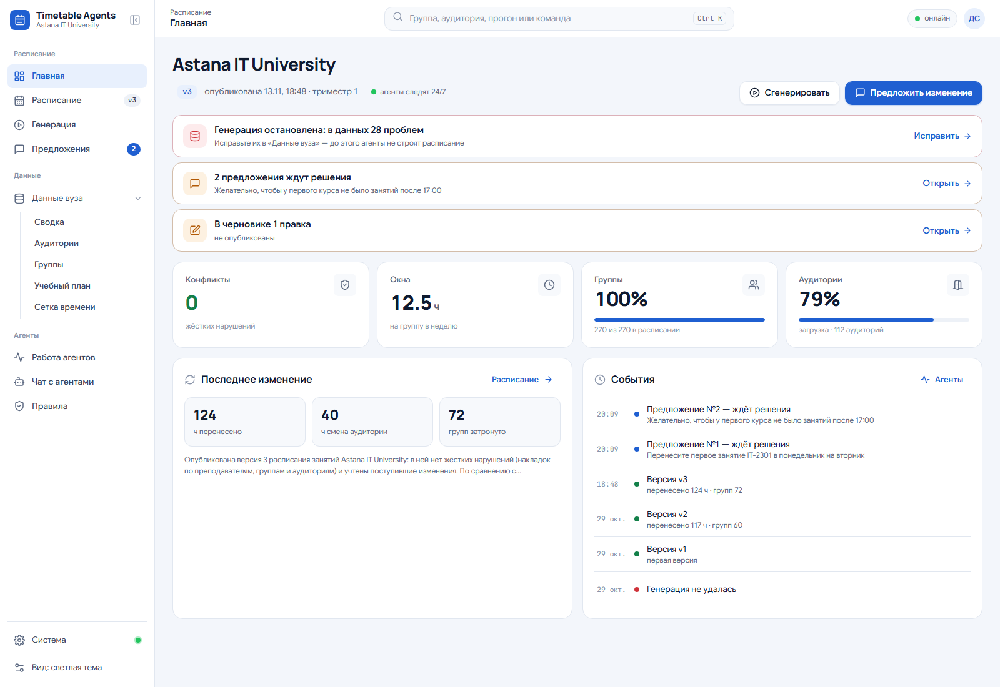
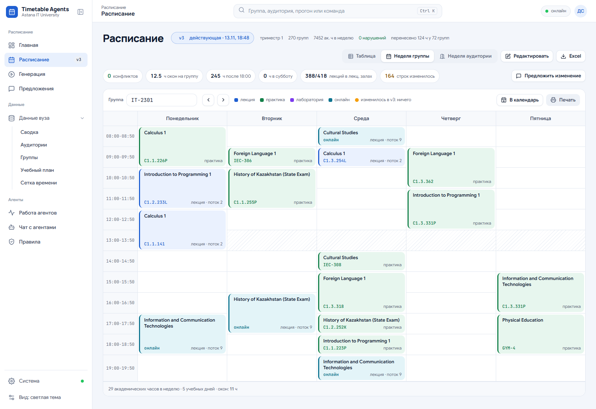
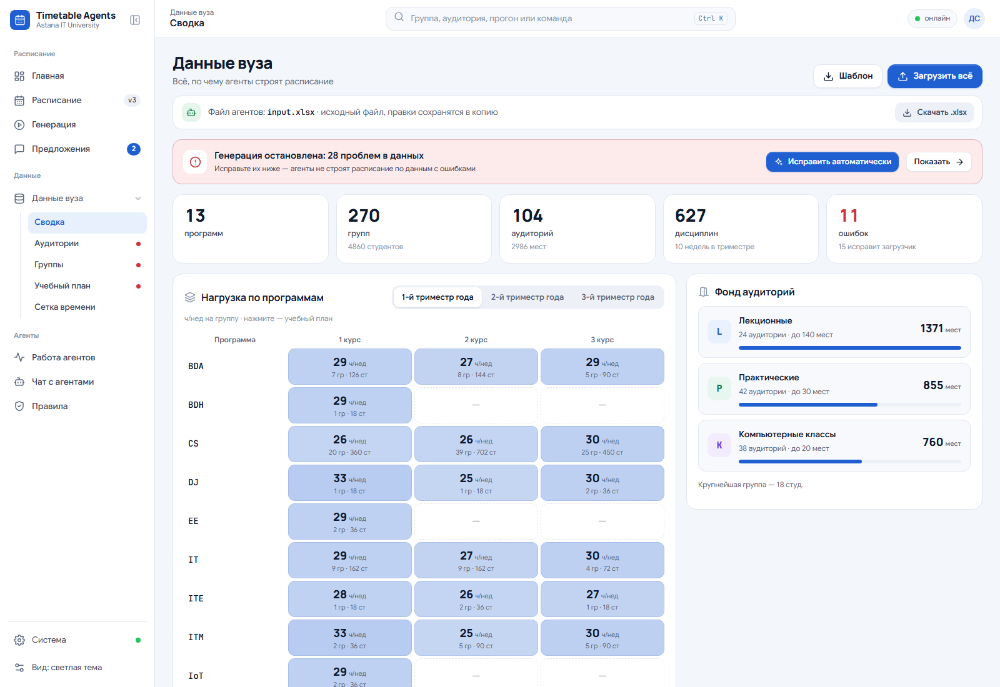
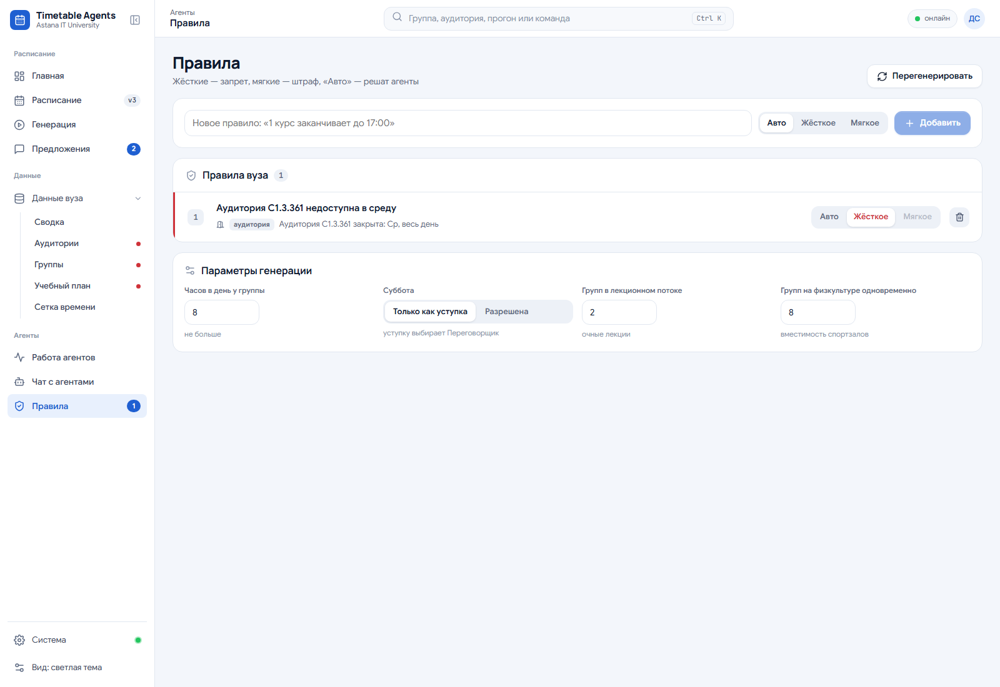
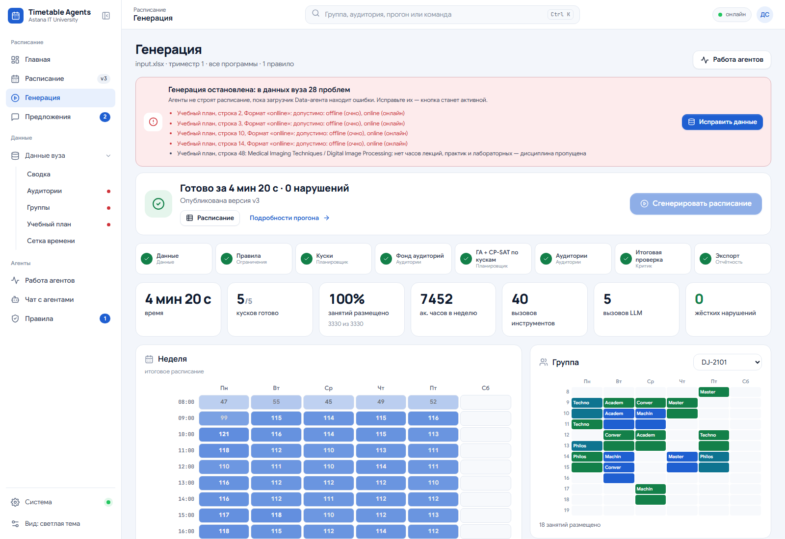
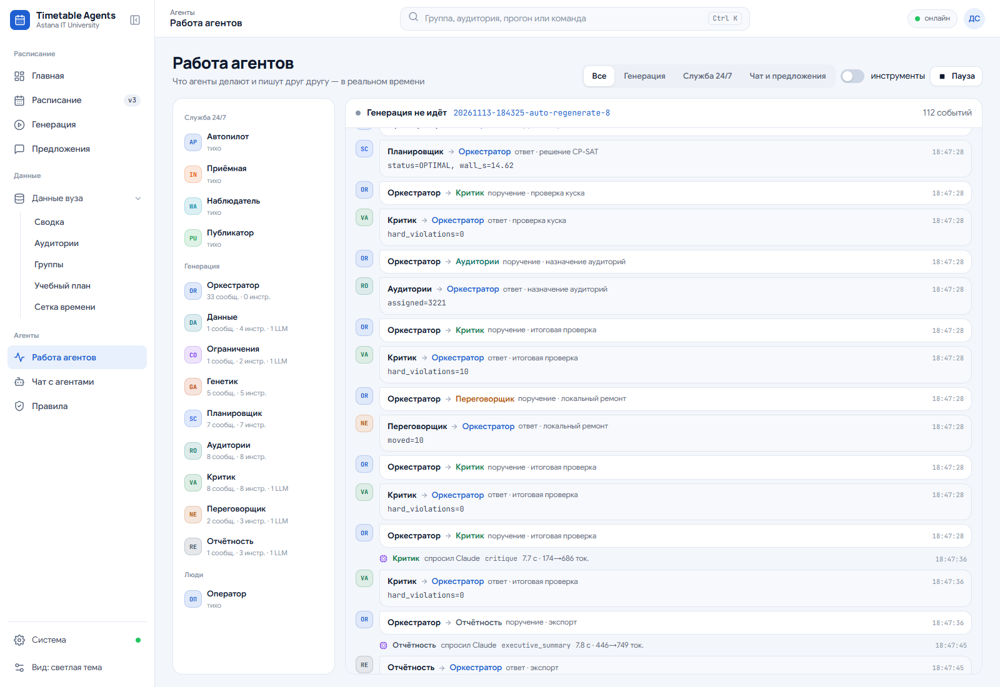
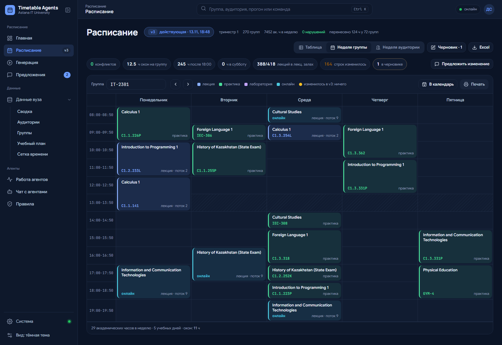
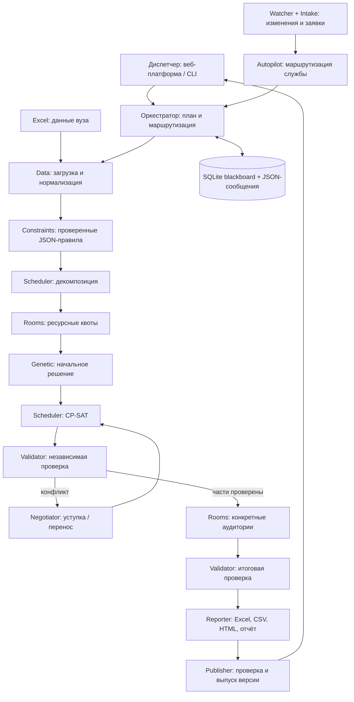

<div align="center">

# Timetable Agents

### Многоагентная система университетского расписания

Учебный проект магистратуры Astana IT University · Artificial intelligence and machine learning

[](requirements.txt)
[](timetable/solver/time_model.py)
[](docs/AGENTS.md)
[](docs/evidence/2026-11-13/published-v3/metrics.json)

**[Результаты](#реальные-результаты) · [Интерфейс](#интерфейс) · [Запуск](#быстрый-запуск) · [Архитектура](#как-работает-система) · [Проверки](#проверки-и-воспроизводимость)**

</div>



Система читает учебные планы, группы и аудитории из Excel, строит недельное расписание и проверяет его независимым валидатором. Диспетчер работает с расписанием в браузере: задаёт правила, отправляет заявки, обсуждает изменения с агентами и редактирует занятия. Служба автопилота запускает пересчёт после изменений и сохраняет опубликованные версии.

Время занятий подбирают генетический алгоритм и OR-Tools CP-SAT. LLM используется для разбора требований, объяснений и выбора уступок. При отсутствии ключа или сбое провайдера конвейер переходит на офлайн-правила.

## Реальные результаты

Срез **13 ноября 2026 года**, часовой пояс UTC+05:00. Ниже приведены результаты опубликованной **v3**, построенной по `data/input.xlsx`, для первого триместра и всех программ. Это один измеренный прогон с тёплым стартом от v2, а не средняя производительность системы.

| Показатель | Результат v3 |
|---|---:|
| Программы / группы в расписании | **13 / 270** |
| Назначенные блоки занятий | **3 330 из 3 330** |
| Недельная нагрузка с учётом каждой группы потока | **7 452 группо-часа** |
| Жёсткие нарушения | **0**, подтверждено повторной независимой проверкой |
| Окна на группу в неделю | **12,50 академического часа** |
| Окна по всем группам | 3 374 академических часа |
| Занятия после 18:00 / в субботу | 245 / 0 академических часов занятий |
| Очные лекции в лекционных залах | 388 из 418, **92,82%** |
| Практика в день раньше первой лекции | 36 блоков |
| Время генерации | **260,3 с** |
| Учтённые вызовы инструментов и LLMRouter | 45 |
| Максимальная доля одного агента в этих вызовах | **20,00%** при пороге 40% |

Источники: [результат прогона](docs/evidence/2026-11-13/published-v3/result.json), [полный журнал](docs/evidence/2026-11-13/published-v3/events.jsonl), [метрики и повторная проверка](docs/evidence/2026-11-13/published-v3/metrics.json), [CSV расписания](docs/evidence/2026-11-13/published-v3/timetable.csv). Методика подсчёта и ограничения приведены в [отчёте](docs/REPORT.md).

**Изменение v2 → v3.** После добавления запрета на использование `C1.3.361` по средам перенесены по времени 124 из 7 452 группо-часов (**1,66%**), ещё для 40 группо-часов изменена аудитория без переноса времени; затронуты 72 группы. Ранее действовавшее закрытие `C1.1.141` по средам сохранено. [Исходная v2](docs/evidence/2026-11-13/published-v3/previous-timetable.csv) и [пересчитанная разница](docs/evidence/2026-11-13/published-v3/metrics.json) приложены к репозиторию.

**Что означает загрузка 79% на главной.** Интерфейс считает 5 334 занятых ресурсных слота из `112 × 5 × 12`: 104 физические аудитории и 8 виртуальных каналов спортзала. Точное значение — **79,375%**. Только для физических аудиторий загрузка равна `4 930 / (104 × 5 × 12)` = **79,01%**. Онлайн-занятия исключены; часы лекционного потока в одной аудитории не считаются повторно для каждой группы.

Покрытие 100% относится к **270 группам, принятым загрузчиком**. В исходном листе 271 группа: `TS-2101` пропущена из-за отсутствующего учебного плана TS. Численность всех групп в наборе равна 18 и является заглушкой. Показатель 4 860 студентов в интерфейсе вычисляется из этих значений и не подтверждает фактический контингент вуза.

## Интерфейс

### Недельное расписание

Группы и аудитории, таблица занятий, подсветка изменений между версиями, выгрузка Excel, печать и календарь `.ics`. В режиме редактирования переносы проходят проверку и сохраняются в черновик; публикация выполняется отдельно.



<table>
<tr>
<td width="50%"><b>Данные вуза</b><br>Аудитории, группы, учебные планы и сетка времени. Проверка ячеек, импорт Excel/CSV, рабочие копии и история.<br><br></td>
<td width="50%"><b>Правила расписания</b><br>Требования на русском языке, предварительный разбор, жёсткий и мягкий режимы, вес пожеланий.<br><br></td>
</tr>
<tr>
<td><b>Ход генерации</b><br>Этапы расчёта, размещённые занятия, недельная карта и готовность частей задачи.<br><br></td>
<td><b>Обмен сообщениями</b><br>Реальные поручения, ответы, проверки и локальный ремонт из журнала v3.<br><br></td>
</tr>
</table>

<details>
<summary>Посмотреть расписание в тёмной теме</summary>



</details>

Скриншоты сняты с работающей локальной платформы 13.11.2026 при ширине 1 600 px. Это состояние экземпляра с опубликованной v3; после чистого клонирования история службы и версии отсутствуют. Оригинальные PNG и параметры съёмки перечислены в [описании изображений](docs/images/README.md).

### Рабочие процессы

| Действие диспетчера | Поведение системы |
|---|---|
| Загрузить или исправить данные | Проверить ячейки и учебную нагрузку; сохранить рабочую копию в `data/uploads/` с историей |
| Добавить правило или заявку | Разобрать требование, проверить сущности; принять, отклонить с причиной или передать диспетчеру |
| Пересчитать расписание | Использовать опубликованную версию как тёплый старт и штрафовать лишние переносы |
| Перетащить занятие | Проверить целевой слот, группы потока, аудиторию и дневную нагрузку; сохранить допустимый перенос в черновик |
| Обсудить предложение | Передать его профильным агентам, показать обсуждение и проверку; принять или отклонить результат |
| Открыть ход генерации | Наблюдать сообщения агентов, этапы обработки частей задачи и размещение занятий |
| Выпустить версию | Проверить результат через Publisher, сохранить снимок и разницу с предыдущей версией |

## Быстрый запуск

Требуются Git и Python 3.12. Команды для PowerShell:

```powershell
git clone https://github.com/Almasmm/multi-agent-timetable.git
cd multi-agent-timetable
py -3.12 -m venv .venv
.venv\Scripts\python -m pip install -r requirements.txt

# Первый запуск без внешней LLM и автоматического фонового пересчёта.
$env:TT_LLM = "offline"
$env:TT_AUTOPILOT = "off"
.venv\Scripts\python -m timetable web --port 8000
```

Открыть **http://127.0.0.1:8000**. Документация API: **http://127.0.0.1:8000/api/docs**, проверка доступности: `/api/health`. Для первой версии выберите данные и откройте раздел «Генерация» либо включите автопилот в настройках системы. Файлы в `runs/` создаются локально и исключены из Git.

На Linux/macOS используйте `python3.12 -m venv .venv`, `.venv/bin/python` и синтаксис переменных своей оболочки. Этот выпуск проверен локально на Windows.

### Примеры CLI

```powershell
# Программа IT: 22 группы, ограничение времени CP-SAT на одну часть задачи.
.venv\Scripts\python -m timetable run --offline --programs IT --seconds 10 --name demo-it

# Требование на естественном языке.
.venv\Scripts\python -m timetable run --offline --programs IT --seconds 10 `
  --require "У группы IT-2301 свободна пятница"

# Все программы, исходный набор данных.
.venv\Scripts\python -m timetable run --offline --seconds 25

# Отдельный мастер-датасет с исправленным учебным планом ITM.
.venv\Scripts\python -m timetable run --offline --data master-dataset/AITU_master_dataset.xlsx

# Служба без веб-интерфейса: обработать очередь до состояния простоя.
.venv\Scripts\python -m timetable autopilot --once
```

`--seconds` задаёт лимит CP-SAT **на одну часть задачи**, а не на весь прогон. Подготовка данных, генетический алгоритм, переговоры, повторы и экспорт требуют дополнительного времени.

### Настройки и LLM

```powershell
Copy-Item .env.example .env
```

| Переменная | Значение по умолчанию | Назначение |
|---|---|---|
| `TT_DATA` | `data/input.xlsx` | Входная книга |
| `TT_TERM` / `TT_WEEKS` | `1` / `10` | Триместр года и недель для расчёта нагрузки |
| `TT_PROGRAMS` | пусто | Все программы; выборка, например `IT,SE` |
| `TT_SOLVER_SECONDS` / `TT_SOLVER_WORKERS` | `25` / `8` | Лимит и параллелизм CP-SAT |
| `TT_CHUNK_GROUPS` | `60` | Целевой размер части задачи в группах |
| `TT_GA` / `TT_GA_SECONDS` | `true` / `4` | Генетическая подготовка начального решения |
| `TT_GYM_CAPACITY` / `TT_ALLOW_SATURDAY` | `8` / `false` | Параллельные группы в спортзале и доступность субботы |
| `TT_MAX_STEPS` / `TT_RUN_TIMEOUT` | `150` / `1800` | Лимиты шагов и времени прогона |
| `TT_LLM` | `auto` | `offline`, `openai`, `claude` или автоматический выбор |
| `TT_OPENAI_MODEL` / `TT_LLM_MODEL` | см. `.env.example` | Идентификаторы моделей для соответствующих провайдеров |
| `TT_AUTOPILOT` / `TT_AUTOPILOT_TICK` | `auto` / `60` | Возобновление сохранённого состояния службы и интервал проверки, с |
| `TT_STABILITY_WEIGHT` | `6` | Штраф за перенос относительно опубликованной версии |

Для OpenAI задайте `OPENAI_API_KEY`, для Anthropic — `ANTHROPIC_API_KEY`. В `auto` конвейер выбирает OpenAI при наличии его ключа, затем Claude, иначе офлайн-правила. Чат агентов использует собственный Claude tool-use цикл с офлайн-фолбэком. Точные настройки: [config.py](timetable/config.py), [шаблон `.env`](.env.example), [LLMRouter](timetable/core/llm.py). `.env` и ключи исключены из репозитория.

В журнале v3 есть пять успешных LLM-вызовов с меткой `claude/claude-opus-5-5`: объяснение данных, разбор правил, выбор уступки, рецензия и резюме. Свежие сценарии отдельно проверяют отказ Claude и OpenAI с переходом на правила; они не измеряют качество работающих внешних моделей.

## Как работает система



Стрелки показывают порядок обработки. Задания маршрутизирует оркестратор; агенты передают типизированные [JSON-сообщения](timetable/core/messages.py), а большие объекты сохраняют в SQLite blackboard. В CP-SAT переменная обозначает начало блока занятия. Сначала учитываются квоты аудиторного фонда по слотам, типам и вместимости, затем подбираются конкретные помещения. [Независимый checker](timetable/solver/checks.py) не использует код построения модели.

### Роли агентов

В конвейере **9 ролей**, в службе **4**. Оркестраторы не выполняют предметные вычисления. Лимит пяти инструментов для `BaseAgent` проверяется при регистрации.

| Агент | Одна роль | Инструменты конвейера или службы |
|---|---|---|
| Orchestrator | Планирование и маршрутизация конвейера | 0 |
| Data | Данные и недельный спрос | `read_workbook`, `normalize`, `build_demand`, `load_previous` |
| Constraints | Разбор и привязка требований | `parse_text`, `ground` |
| Genetic | Подготовка начального решения | `evolve` |
| Scheduler | Декомпозиция и назначение времени | `partition`, `cp_sat_solve` |
| Rooms | Квоты и конкретные аудитории | `capacity`, `quota`, `assign` |
| Validator | Независимая проверка | `check` |
| Negotiator | Разрешение конфликтов | `decide`, `apply`, `local_repair` |
| Reporter | Экспорт и отчёт | `export_tables`, `export_html`, `write_report` |
| Autopilot | Маршрутизация службы | 0 |
| Intake | Разбор заявок сотрудников | `ground`, `summarize`, `record` |
| Watcher | Наблюдение и предложение задания | `fingerprint`, `inbox`, `propose` |
| Publisher | Проверка и выпуск версии | `evaluate`, `publish`, `announce` |

Контракты входов/выходов, критерии завершения и отдельные наборы чат-инструментов: [docs/AGENTS.md](docs/AGENTS.md). Модель, ограничения и обмен сообщениями: [docs/ARCHITECTURE.md](docs/ARCHITECTURE.md).

### Автопилот и публикация

Служба проверяет изменения файла и новые заявки, запускает генерацию или улучшение, затем передаёт результат Публикатору. Для выпуска требуются статус `ok` и отсутствие жёстких нарушений. Поиск улучшения должен уменьшить штраф минимум на 2%; при заданной `stable_after` дополнительно применяется лимит переносов `max_moved_share`.

Штраф: `окна + 2 × часы после 18:00 + 3 × часы в субботу + 0,5 × нарушения порядка`. В v3 он равен **3 882**. Перегенерация по новым обязательным требованиям может иметь больший штраф, чем предыдущая версия: v2 имела 3 873. Порог улучшения не является условием для каждого изменения правил.

## Данные и артефакты

| Источник | Содержимое и границы применения |
|---|---|
| [data/input.xlsx](data/input.xlsx) | Исходный набор для v3 и сценариев: после нормализации 13 программ, 270 групп, 104 аудитории, 627 строк дисциплин |
| [master-dataset/AITU_master_dataset.xlsx](master-dataset/AITU_master_dataset.xlsx) | Подготовленная книга: исправлен план ITM, добавлены справочные поля; после загрузки 626 строк дисциплин |
| [master-dataset/AITU_template.xlsx](master-dataset/AITU_template.xlsx) | Шаблон с примерами для заполнения |
| [Описание мастер-датасета](master-dataset/README.md) | Схема листов, происхождение, незаполненные поля и пока не учитываемые сущности |

Это **разные версии входных данных**. Мастер-датасет даёт 3 334 блока и 7 440 группо-часов спроса для первого триместра; показатели v3 с исходного Excel к нему не относятся. Сетка исходных данных: Пн–Сб, 12 академических часов в день, 08:00–19:50; по умолчанию расчёт использует Пн–Пт.

| Файл в `runs/<id>/` | Назначение |
|---|---|
| `timetable.xlsx` / `timetable.csv` / `timetable.html` | Расписание для использования и анализа |
| `report.md` / `result.json` | Выводы, замечания, статус, метрики и параметры |
| `events.jsonl` | Вызовы инструментов, LLM, сообщения и ошибки |
| `state.sqlite` | Полные сообщения и состояние blackboard |
| `runs/_service/` | Заявки, задания, чат, черновик и неизменяемые снимки опубликованных версий |

## Проверки и воспроизводимость

Результаты локальной проверки 13.11.2026: **58 тестов** модулей, API, службы, редактора, чата, данных и предложений; **19/19 сквозных сценариев**. Дополнительно открыты **9 представлений в Chrome** без ошибок JavaScript и локальных HTTP-запросов. [Протокол тестов](docs/evidence/2026-11-13/tests.xml), [браузерная проверка](docs/evidence/2026-11-13/browser-qa.json), [таблица сценариев](docs/scenario_results.md), [подробный отчёт](docs/REPORT.md). Docker, Jenkins и Kubernetes в этой проверке заново не запускались.

```powershell
# Все тесты, кроме сценариев, которые ниже запускаются отдельной командой.
.venv\Scripts\python -m pytest --ignore=tests/test_scenarios.py

# 19 сценариев; обновляет docs/scenario_results.md.
.venv\Scripts\python -m timetable.scenarios

# Или весь набор одним запуском, включая сценарии.
.venv\Scripts\python -m pytest

# Проверить SHA-256, повторить checker и пересчитать CSV / журнал опубликованной v3.
.venv\Scripts\python scripts/verify_readme_evidence.py docs/evidence/2026-11-13/published-v3
```

<details>
<summary>Что проверяют 19 сценариев</summary>

| Сценарии | Проверка |
|---|---|
| S01–S06 | Базовое расписание, время окончания, свободный день, закрытая аудитория, дневной лимит, мягкое пожелание |
| S07 | Дефицит спортзала и переговоры с выбором уступки |
| S08–S09 | Неизвестная аудитория и непонятное требование |
| S10–S11 | Отсутствующий файл и остановка по лимиту шагов |
| S12 | Доля каждого агента не выше 40% по полному журналу |
| S13, S17 | Отказ Claude / OpenAI и офлайн-фолбэк |
| S14–S16 | Очистка данных, экспорт, второй триместр |
| S18 | Тёплый старт после закрытия аудитории |
| S19 | Полный цикл службы: v1 → заявки → пересчёт → v2 |

S10 и S11 проходят при **ожидаемом отказе или остановке**. Нулевые нарушения в S07 относятся к правилам после зафиксированной уступки. Реализация и точные проверки: [scenarios.py](timetable/scenarios.py).

</details>

Нагрузка агента — доля событий `tool_call` и `llm_call` с первой попыткой среди всех таких событий полного прогона, включая Reporter. Это число вызовов, а не процессорное время, токены или стоимость API. Служебные опросы Watcher за день в этот показатель конвейера не входят. Встроенное поле `load` в `result.json` фиксируется до Reporter; для итогов используется пересчёт JSONL. В офлайн-режиме `llm_call` означает вызов маршрутизатора с выполнением правил.

Многопоточный CP-SAT и лимиты времени допускают различия при повторном запуске даже с тем же seed. Скрипт проверки приложенных снимков проверяет сохранённый результат; новая генерация может дать другое корректное расписание.

## Ограничения

Окна остаются заметной проблемой: 12,5 академического часа на группу в опубликованной v3. Глобальный оптимум не доказан. Преподаватели, их занятость, языковые подгруппы и выбор дисциплин пока не входят в модель; дополнительные листы мастер-датасета сохраняются для дальнейшей работы. Вместимость проверяется по имеющимся значениям численности групп, которые требуют уточнения.

Переговорщик может открыть субботу для части задачи или смягчить пользовательские запреты времени. Текущее ослабление затрагивает все такие запреты части, а не только виновное правило. Итог «0 нарушений» всегда нужно читать вместе с журналом уступок. В v3 переговоры увеличили время решения; два закрытия аудиторий остались жёсткими.

Платформа рассчитана на локальную работу диспетчера. В HTTP API нет аутентификации и разграничения ролей. Перед внешним развёртыванием требуется отдельная настройка доступа и эксплуатации. Текущая проверка подтверждает функциональные сценарии, а не непрерывную работу с гарантированным SLA.

## Документация и структура

| Материал | Что читать |
|---|---|
| [Отчёт с методикой и результатами](docs/REPORT.md) | Источники цифр, единицы измерения, баланс агентов, ограничения |
| [Архитектура](docs/ARCHITECTURE.md) / [агенты](docs/AGENTS.md) | Решатель, протоколы, инструменты и рабочие процессы |
| [Протокол сценариев](docs/scenario_results.md) / [evidence](docs/evidence/2026-11-13/README.md) | Результаты проверок и контрольные суммы |
| [DevOps](docs/DEVOPS.md) | Docker, Jenkins multibranch и Minikube |
| [Учебный отчёт Word](docs/Murat_Almas_CSE_2503_multiagent_timetable_generation.docx) | Отдельный материал проекта; численные итоги текущего среза приведены выше |

```text
timetable/
  core/       агенты, JSON-сообщения, SQLite, LLMRouter, журнал
  domain/     Excel, нормализация, спрос, правила, импорт учебных планов
  solver/     генетический алгоритм, CP-SAT, ресурсы, проверка, переносы
  agents/     оркестратор и восемь предметных агентов
  service/    автопилот, заявки, версии, редактор, чат, предложения, данные
  web/        FastAPI, ход генерации, SPA без сборки
tests/        модульные, API и сквозные проверки
data/         исходный Excel и локальные рабочие загрузки
master-dataset/  подготовленные данные и шаблон
docs/         отчёты, архитектура, скриншоты и evidence
scripts/      проверка evidence и инструменты DevOps
ci/ · k8s/    Jenkins и манифесты Kubernetes
runs/         локальные результаты и состояние службы; не входят в Git
```
