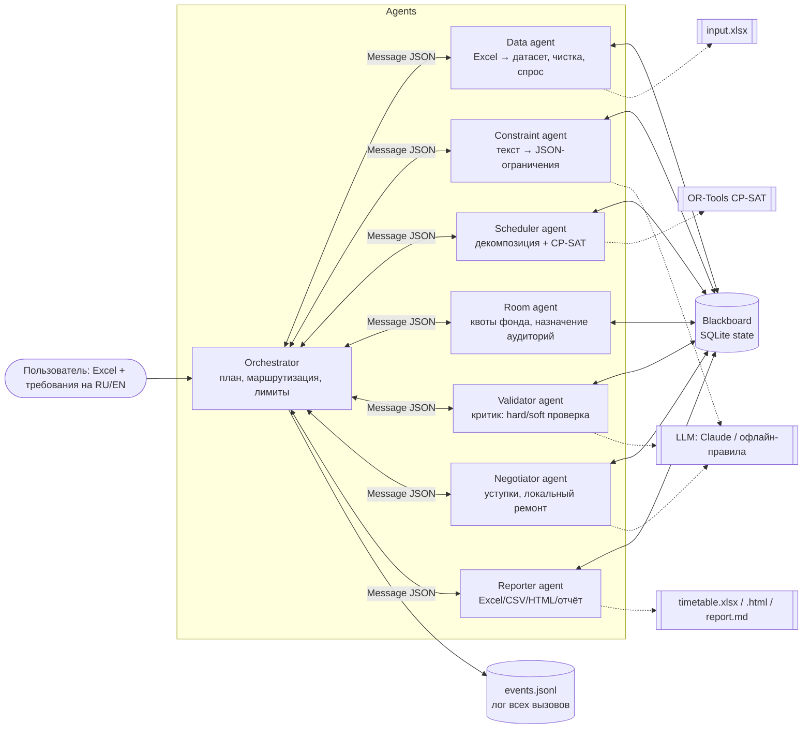
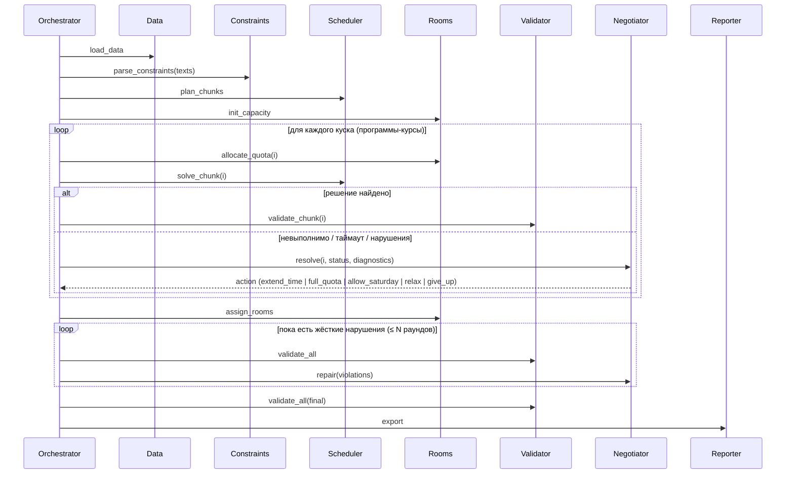

# Архитектура: многоагентная генерация расписания университета

## 1. Почему команда агентов, а не один агент

Составление расписания — это **конфликт интересов нескольких сторон за общий ресурс**:
у каждой образовательной программы свои группы и свои пожелания, а аудиторный фонд
(104 аудитории после нормализации × 60 слотов в неделю) и спортзал общие. Один «агент-решатель» на всю
задачу упирается в три проблемы:

1. **Масштаб.** 270 групп, около 3300 недельных занятий и 72 слота дают модель с сотнями тысяч
   переменных. Декомпозиция на куски (программа-курс) с квотами общего ресурса решает
   это за минуты на ноутбуке, но требует **посредника, который делит ресурс** (Room agent).
2. **Разные компетенции.** Разбор пожеланий на естественном языке (LLM), строгая
   комбинаторная оптимизация (CP-SAT), учёт аудиторного фонда, независимая проверка и
   переговоры об уступках — это разные роли, у них разные инструменты и критерии готовности.
3. **Надёжность.** Решатель не должен сам себя проверять. Независимый агент-критик
   (Validator) перепроверяет каждое решение другим кодом. Переговорщик (Negotiator) решает,
   какой уступкой разблокировать невыполнимый кусок: больше времени, больше аудиторий,
   суббота или ослабление правил.

## 2. Схема взаимодействия

Схема — **оркестратор + общая память (blackboard)**. Оркестратор только планирует и
маршрутизирует типизированные JSON-сообщения. Большие объекты (датасет, решения) лежат
на blackboard (SQLite), а в сообщениях передаются ключи и статусы.



### Последовательность (типовой сценарий)



## 3. Модель задачи

* **Слоты:** 6 дней × 12 академических часов (08:00–19:50). Суббота закрыта, пока её не откроет Negotiator.
* **Занятия (sessions):** недельные часы = слоты курса / 10 недель. Разбиваются на пары (2+1 при
  3 ч/нед), как в реальном расписании. Лекции читаются потоками (по умолчанию 2 группы оффлайн,
  до 50 групп онлайн), практики и лабораторные — по группам.
* **Жёсткие ограничения:** каждое занятие ровно один раз; группа на одном занятии в слот;
  аудитории в пределах квоты (счётные ресурсы ROOMS/K/CAP≥n/GYM, условие Холла); блоки одного
  компонента в разные дни; лимит часов в день; запреты пользователя; лабораторные только в K-аудиториях;
  вместимость.
* **Мягкие ограничения (минимизируются):** одиночные и двойные «окна», ранние и поздние часы,
  суббота, «лекция раньше практики» в неделе, мягкие пожелания пользователя.
* **Декомпозиция:** единицы «программа-курс» упаковываются в куски по ~60 групп. Room agent
  выдаёт каждому куску справедливую долю остатка фонда (пропорционально спросу × 1.15).
  Решение коммитится только после проверки Validator. Затем аудитории назначаются
  жадным интервальным алгоритмом (best fit, предпочтение типа).

## 4. Надёжность и безопасность

| Механизм | Где |
|---|---|
| Лимит шагов оркестратора (по умолчанию 150) — защита от зацикливания | `Orchestrator.send` |
| Общий таймаут прогона и таймаут каждого инструмента | `RunContext.check_deadline`, `BaseAgent.call_tool` |
| Ретраи с экспоненциальной паузой для временных ошибок; детерминированные ошибки не ретраятся | `BaseAgent.call_tool` |
| Лимит раундов переговоров на кусок и раундов ремонта | `TT_MAX_NEGOTIATION` |
| LLM недоступен → офлайн-правила, без падения; сбой логируется | `LLMRouter._run` |
| LLM не может выбрать недопустимое действие: ответ валидируется по белому списку | `NegotiatorAgent._decide` |
| Понятные сообщения при сбое (нет файла, нет листа, пустой спрос) | `loader.py`, `Orchestrator._abort` |
| Лог всех сообщений, вызовов инструментов и LLM (JSONL) + состояние в SQLite | `runs/<id>/events.jsonl`, `state.sqlite` |
| Ключи API только из окружения / `.env` (в `.gitignore`) | `config.py`, `.env.example` |
| Не более 5 инструментов на агента — проверяется в коде | `BaseAgent.add_tool` |

## 5. Веб-платформа

Тонкий слой над тем же пайплайном (`timetable/web/`), агенты о нём не знают:

```mermaid
flowchart LR
    B[Браузер: SPA<br/>index.html + app.js] -->|JSON /api/*| S[FastAPI server.py]
    S --> M[RunManager runs.py<br/>поток на прогон, отмена, список]
    M -->|app.run(settings, requirements, cancel)| O[Orchestrator + агенты]
    O --> F[(runs/&lt;id&gt;/<br/>events.jsonl · state.sqlite<br/>timetable.csv · report.md)]
    S -->|читает по смещению / SQL| F
```

* Живой режим: браузер раз в секунду запрашивает `GET /api/runs/{id}/events?offset=N` — новые строки
  `events.jsonl`; из них строятся схема активных агентов, прогресс по кускам и журнал.
* Результаты: `timetable.csv` → сетка расписания; `state.sqlite` → полные payload сообщений
  (переговоры, вердикты, диагнозы), blackboard (validation, constraint_specs, run_params, repairs,
  critique, dataset.issues); `report.md` и файлы — для скачивания.
* Безопасность: имена прогонов и файлов проверяются по белому списку, датасеты — только из
  разрешённых папок, загрузка только `.xlsx` до 20 МБ, один прогон одновременно, отмена через
  `RunContext.cancel`.

## 6. Ограничения и что дальше

* В данных нет преподавателей, поэтому конфликты преподавателей не моделируются. Модель
  расширяется так же, как группы: ещё одно ограничение `AtMostOne` по преподавателю на слот.
* Альтернативные курсы («Russian 1 / Kazakh 1») считаются одним занятием группы в одной аудитории
  (на практике группа делится на подгруппы).
* Декомпозиция жадная по кускам: глобальный оптимум не гарантируется. Справедливые квоты и
  переговоры компенсируют это, а качество измеряется метриками критика.
