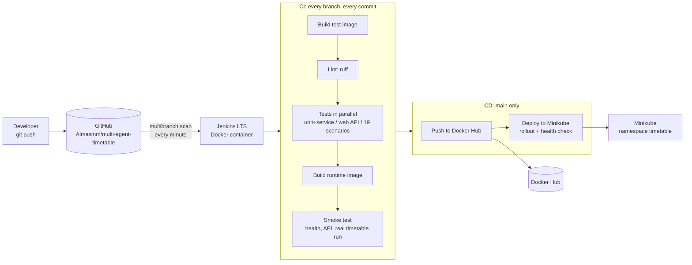

# DevOps and CI/CD

This document describes how the multi-agent timetable generator is containerised, tested, built and
deployed automatically. Everything is stored in the repository as code: the Docker image (`Dockerfile`),
the Jenkins server (`ci/jenkins/`), the pipeline (`Jenkinsfile`) and the Kubernetes deployment (`k8s/`).

## Overview



| Component | File(s) | Purpose |
|---|---|---|
| Application image | `Dockerfile`, `.dockerignore` | Three stages: `deps` (pinned virtualenv), `test` (deps + dev tools + tests), `runtime` (app only, non-root, HEALTHCHECK) |
| Local run | `docker-compose.yml` | `docker compose up -d --build` → http://localhost:8000, run results in named volumes |
| Jenkins server | `ci/jenkins/Dockerfile`, `plugins.txt`, `casc.yaml`, `docker-compose.yml` | Jenkins LTS with Docker CLI and kubectl; users, credentials and the job are configured as code (JCasC + Job DSL) |
| Pipeline | `Jenkinsfile`, `ci/scripts/*.sh` | Declarative pipeline; shell scripts keep each stage short and testable outside Jenkins |
| Kubernetes | `k8s/cluster/` (admin, once), `k8s/app/` (Jenkins, every deploy) | Namespace with Pod Security "restricted", least-privilege ServiceAccount for Jenkins, Deployment/Service/PVC/ConfigMap |
| Automation scripts | `scripts/devops/*.ps1` | Install/start Minikube, issue the Jenkins kubeconfig, bring the whole stack up or down |
| Health endpoint | `GET /api/health` (`timetable/web/server.py`) | Used by the Docker HEALTHCHECK, the smoke test and the Kubernetes probes |

## Quick start (Windows, Docker Desktop)

```powershell
# 1. Minikube (downloaded and checksum-verified on first run) + namespace/RBAC + Jenkins kubeconfig,
#    then Jenkins itself; creates ci/jenkins/.env with a random admin password on first run.
powershell -ExecutionPolicy Bypass -File scripts/devops/up.ps1 -InstallMinikube

# 2. Open http://localhost:8080, log in with JENKINS_ADMIN_ID / JENKINS_ADMIN_PASSWORD from ci/jenkins/.env.
#    The job "multi-agent-timetable" already exists; it scans GitHub every minute.

# 3. Any push starts a build of the pushed branch. main also pushes the image and deploys it:
#    http://<minikube ip>:30080  (or: minikube service timetable -n timetable)

# Stop everything (data is kept); -Purge deletes Jenkins data and the Minikube cluster.
powershell -ExecutionPolicy Bypass -File scripts/devops/down.ps1
```

Docker Hub push is optional: fill `DOCKERHUB_USER`, `DOCKERHUB_TOKEN` (a personal access token with
Read & Write scope) and `DOCKERHUB_REPO` in `ci/jenkins/.env`, then recreate the container
(`docker compose -f ci/jenkins/docker-compose.yml up -d`). With an empty `DOCKERHUB_REPO` the stage is skipped.

Run the application image without Jenkins:

```bash
docker compose up -d --build          # http://localhost:8000
docker build --target test -t multi-agent-timetable:test .
docker run --rm multi-agent-timetable:test                  # full pytest suite inside the image
```

## Pipeline stages

| # | Stage | Branches | What it does | Fails when |
|---|---|---|---|---|
| 1 | Prepare | all | Computes `IMAGE_TAG = <branch>-<short sha>`, prints commit and Docker version | — |
| 2 | Build test image | all | `docker build --target test` (dependency layer is cached between builds) | dependencies cannot be installed |
| 3 | Lint | all | `ruff check timetable tests` (syntax errors, undefined names, unused imports/variables) | any lint error |
| 4 | Tests (parallel) | all | three containers from the test image: unit + 24/7 service, web API with a real run, 19 end-to-end scenarios; JUnit + Cobertura reports are copied out with `docker cp` | any test fails |
| 5 | Build image | all | `docker build --target runtime` with OCI labels (version, git revision, build date) | build error |
| 6 | Smoke test | all | starts the image, waits for Docker health = healthy, checks non-root user, `/api/health`, `/api/agents` (9 agents, ≤ 5 tools each), dataset (270 groups), UI, and generates a real timetable for the IT programme (0 hard violations required) | any check fails |
| 7 | Push to Docker Hub | main | `docker login --password-stdin` with a Jenkins credential in a temporary `DOCKER_CONFIG`, pushes `<tag>` and `latest` | registry error |
| 8 | Deploy to Minikube | main | copies the image into the Minikube node, `kubectl apply -k` with the build's tag, `rollout status`, checks `/api/health` through the NodePort | rollout does not complete in 240 s, health check fails |

Post actions: test reports and the generated Kubernetes overlay are archived; the test image is removed;
the workspace is cleaned. The pipeline has a 40-minute timeout and never runs two builds of one branch at once.

### Trigger on every commit

The job is a multibranch pipeline (`casc.yaml`, Job DSL). A local Jenkins has no public URL, so GitHub
webhooks cannot reach it; instead the job scans the repository every minute (`periodicFolderTrigger`) and
starts a build for every branch whose head commit changed. New branches get their own pipeline automatically,
deleted branches are cleaned up. With a public Jenkins the same job would use a GitHub webhook.

## Design decisions

**Tests run inside the image that is shipped.** CI does not install Python on the Jenkins controller: the
`test` stage of the same Dockerfile provides exactly the Python 3.12, OR-Tools and library versions of the
runtime image. This makes test results reproducible on any machine with Docker.

**Jenkins uses the host Docker engine** through `/var/run/docker.sock`. This is simpler than Docker-in-Docker
and lets the CD stage hand images to Minikube. Access to the socket is equivalent to root on the Docker host,
therefore Jenkins listens on `127.0.0.1` only, signup is disabled and anonymous users cannot read anything.
Because the engine cannot see paths inside the Jenkins container, test reports are copied with `docker cp`
instead of bind mounts.

**Secrets never enter git or images.** `.env`, `ci/jenkins/.env` and `ci/jenkins/secrets/` are git-ignored,
`.dockerignore` excludes them from the build context. Jenkins receives Docker Hub and Kubernetes credentials
through JCasC and exposes them to a single stage via `withCredentials`, which masks them in logs.
LLM API keys for the cluster go into an optional Secret `timetable-llm`; without keys the system uses its
offline rules, so CI never calls an external LLM.

**Least privilege in Kubernetes.** Jenkins deploys with the ServiceAccount `jenkins-deployer`, whose Role
covers Deployments, ReplicaSets, Services, ConfigMaps and PVCs in namespace `timetable` only and cannot read
Secrets (`minikube-setup.ps1` verifies this with `kubectl auth can-i`). The namespace enforces Pod Security
"restricted"; the pod runs as uid 10001 with a read-only root filesystem, no capabilities and seccomp
`RuntimeDefault`.

**One replica, Recreate strategy.** The 24/7 service stores its state in SQLite on a ReadWriteOnce volume, so
two pods must never write at the same time. Startup, readiness and liveness probes use `/api/health`.

**Versioning.** Every image is tagged `<branch>-<short sha>` and labelled with the git revision, so a running
pod can be traced back to its commit; `kubectl rollout history` records the Jenkins build number.

## Troubleshooting

| Symptom | Cause and fix |
|---|---|
| Jenkins does not start, log mentions `readFileBase64` | `ci/jenkins/secrets/kubeconfig` is missing: run `scripts/devops/minikube-setup.ps1` before Jenkins |
| `network minikube declared as external, but could not be found` | Minikube is not running: `minikube start` or `scripts/devops/up.ps1` |
| Deploy stage: connection refused to 192.168.49.2:8443 | Minikube was restarted with a new IP: re-run `minikube-setup.ps1`, then `docker compose -f ci/jenkins/docker-compose.yml up -d` |
| `permission denied ... docker.sock` | the container lost `group_add: ["0"]`; recreate it with the compose file |
